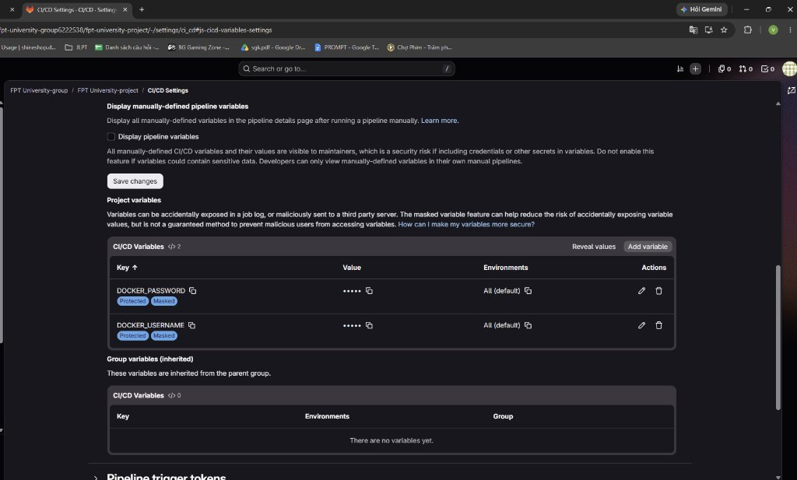

# Bài tập 4: Đẩy Docker Image lên Docker Hub thông qua GitLab CI (DinD)

## 1. Cấu trúc Pipeline ([`.gitlab-ci.yml`](./.gitlab-ci.yml))
- Mở rộng từ Bài 3 (`test` $\rightarrow$ `build` $\rightarrow$ `dockerize`).
- Stage `dockerize` (`dockerize_job`) nhận artifact `build/libs/*.jar` từ `build_job`, sử dụng `docker:24.0` + service `docker:24.0-dind` (Docker-in-Docker), đăng nhập bằng biến bảo mật `$DOCKER_USERNAME` và `$DOCKER_PASSWORD`, build từ [`Dockerfile`](./Dockerfile) và push lên Docker Hub (`$DOCKER_USERNAME/hr-servic:$CI_COMMIT_SHORT_SHA` và `:latest`).

## 2. Docker Hub Repository
- **URL Repository:** https://hub.docker.com/r/vananvu249/hr-servic (https://hub.docker.com/repository/docker/vananvu249/hr-servic)

## 3. Ảnh chụp cấu hình CI/CD Variables trên GitLab (`DOCKER_USERNAME` & `DOCKER_PASSWORD`)

